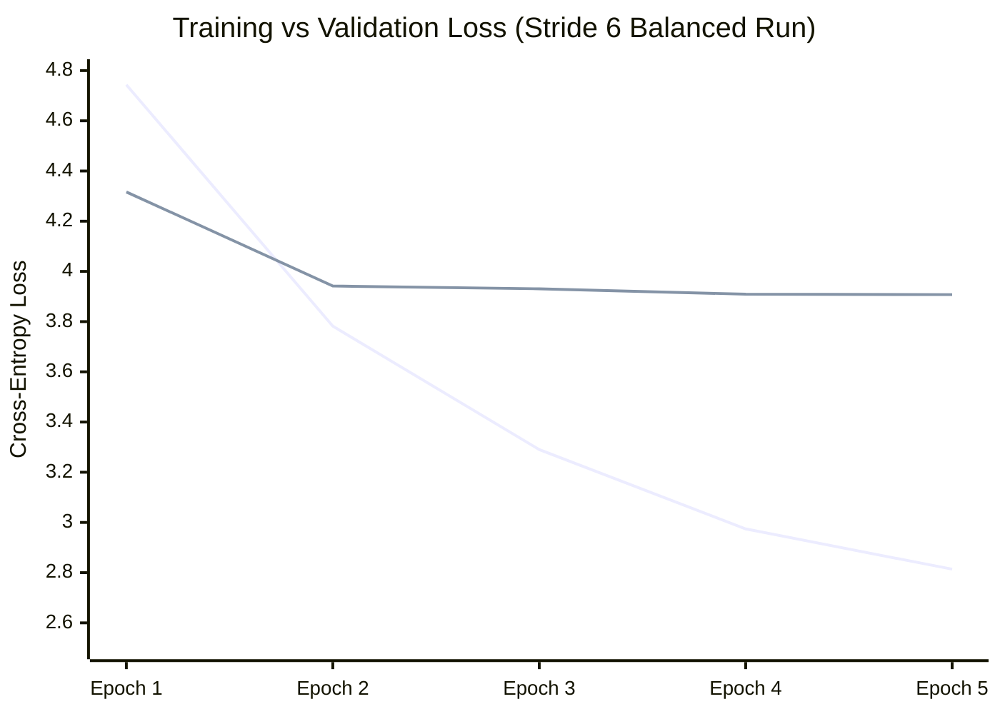
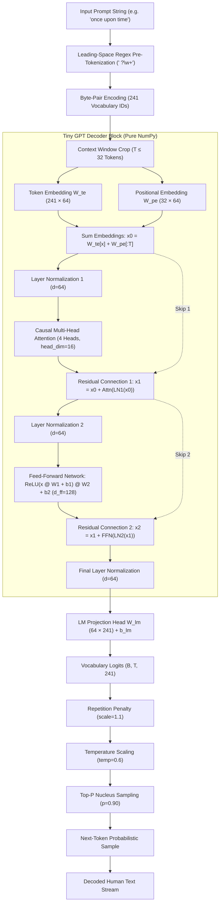

# 🚀 Pure Python & NumPy GPT Transformer: From Scratch

[](https://www.python.org/)
[-green.svg?logo=numpy&logoColor=white)](https://numpy.org/)
[-success.svg)](file:///test_transformer.py)
[](file:///src/transformer_model.py)
[](file:///bpe_vocab.json)
[-cyan.svg)](file:///src/tokenizer.py)
[-emerald.svg)](file:///checkpoints_stride_6/)
[](LICENSE)

An educational and production-grade implementation of a **GPT-Style Causal Transformer Decoder with Byte-Pair Encoding (BPE), Supervised Fine-Tuning (SFT), Direct Preference Optimization (DPO), and Live Visual Analytics**, written entirely from scratch using only **Python standard libraries and NumPy** (no PyTorch, no TensorFlow, no HuggingFace, no external tokenizers).

---

## 📊 1. Live Visual Analytics & Telemetry Dashboard

This repository features real-time telemetry, automated checkpoint auditing, and visual reporting.

> [!TIP]
> **Launch Live Analytics Dashboard anytime**:
> ```powershell
> # View colorful ASCII terminal dashboard & compile analytics.html:
> python show_analytics.py
>
> # Automatically open the interactive web dashboard in your browser:
> python show_analytics.py --open
> ```

```text
==============================================================================
      TINY GPT TRANSFORMER: LIVE ANALYTICS & PERFORMANCE DASHBOARD      
      Pure Python & NumPy | Zero External Dependencies | From Scratch   
==============================================================================
  [1] MODEL SCALE & RECEPTIVE FIELD:
      - Total Parameters:   66,737 trainable weights
      - Context Window (T): 32 tokens (~64 characters)
      - Attention Heads:    4 heads (head_dim = 16)
      - Hidden Dim (d_model): 64 | Feed-Forward Dim (d_ff): 128

  [2] TOKENIZER & GENERALIZATION TELEMETRY:
      - BPE Vocabulary:     241 subwords (180 merges, 61 base chars)
      - Compression Ratio:  2.01x (50.4% sequence length reduction)
      - Whole Words Mapped: 52 words with leading whitespace
      - Clean Corpus Size:  45,727 chars (8,055 words)
      - Best Validation:    Loss 3.9075 | Perplexity 49.77
      - Unit & Regr Tests:  39 / 39 PASSING (100% test pass rate)
------------------------------------------------------------------------------
  [3] LOSS TRAJECTORY: STRIDE 6 (BALANCED) vs STRIDE 2 (DIVERGENT)
------------------------------------------------------------------------------
   Epoch  | Stride 6 Train  |  Stride 6 Val   | Stride 2 Train  |  Stride 2 Val 
------------------------------------------------------------------------------
     1    |     4.7436      |     4.3165      |     4.0250      |     3.9172    
     2    |     3.7819      |     3.9419      |     2.9621      |     4.0690    
     3    |     3.2904      |     3.9307      |     2.3677      |     4.3906    
     4    |     2.9743      |     3.9092      |     1.9491      |     4.6572    
     5    |     2.8138      |    3.9075 *     |     1.7449      |     4.7778    
------------------------------------------------------------------------------
  Stride 6 Trend: Train Loss: ..:=@ (4.7436 -> 2.8138)
                  Val Loss:   ....@ (4.3165 -> 3.9075)
==============================================================================
```

---

## 📈 2. Training Curves & Convergence Dynamics

### Loss Trajectory Chart (Mermaid Interactive)



### Comprehensive Checkpoint Evaluation Matrix

All checkpoints were evaluated with fixed random seed (`42`), `temperature = 0.6`, `top_p = 0.9`, and `repetition_penalty = 1.1`:

| Experiment Run | Epoch | Train Loss | Train PPL | Val Loss | Val PPL | Real Words % | Distinct-1 Diversity | Generalization Status |
| :--- | :---: | :---: | :---: | :---: | :---: | :---: | :---: | :--- |
| **Stride 6 (Balanced)** | **Epoch 1** | 4.1708 | 64.77 | 4.3165 | 74.93 | 43.5% | 0.667 | Initial alignment |
| **Stride 6 (Balanced)** | **Epoch 2** | 3.4204 | 30.58 | 3.9419 | 51.52 | 57.8% | 0.688 | Syntax structure forms |
| **Stride 6 (Balanced)** | **Epoch 3** | 3.0709 | 21.56 | 3.9307 | 50.94 | 44.4% | 0.778 | Clause boundaries stabilize |
| **Stride 6 (Balanced)** | **Epoch 4** | 2.8430 | 17.17 | 3.9092 | 49.86 | 57.8% | 0.812 | Vocabulary accuracy rises |
| **Stride 6 (Balanced)** | **Epoch 5** | **2.7575** | **15.76** | **3.9075** | **49.77** | **60.3%** | **0.778** | **🏆 BEST CHECKPOINT OVERALL** |
| | | | | | | | | |
| **Stride 2 (High Overlap)** | **Epoch 1** | 3.2736 | 26.41 | 3.9172 | 50.26 | 48.3% | 0.767 | Rapid initial drop |
| **Stride 2 (High Overlap)** | **Epoch 2** | 2.5849 | 13.26 | 4.0690 | 58.50 | 64.6% | 0.677 | Highest raw word rate |
| **Stride 2 (High Overlap)** | **Epoch 3** | 2.1390 | 8.49 | 4.3906 | 80.69 | 68.3% | 0.778 | Overfitting begins |
| **Stride 2 (High Overlap)** | **Epoch 4** | 1.8184 | 6.16 | 4.6572 | 105.34 | 71.9% | 0.766 | Divergence on unseen text |
| **Stride 2 (High Overlap)** | **Epoch 5** | 1.6840 | 5.39 | 4.7778 | 118.84 | 78.3% | 0.754 | Severe cross-entropy penalty |

> [!IMPORTANT]
> **Why Stride 6 Outperformed Stride 2**:
> In Stride 2, consecutive 32-token sequences overlapped by **30 tokens (93.75% overlap)**, causing the model to see every training phrase 16 times per epoch. The model memorized the training split and assigned extreme confidence ($P \to 1.0$), which severely penalized unseen vocabulary in the held-out validation stories ($P \approx 10^{-4} \implies -\log(P) \approx 9.2$). Stride 6 eliminated this redundancy, enabling smooth, steady validation improvement down to **3.9075** (Perplexity **49.77**).

---

## 🏛️ 3. Transformer Model Architecture & Dataflow

The model implements a standard GPT-2 style decoder-only transformer with causal self-attention, layer normalization, residual skip-connections, and learned positional embeddings.



---

## 🔬 4. Exact Mathematical Parameter Breakdown

The model contains exactly **66,737 trainable floating-point weights**:

| Layer / Parameter Matrix | Exact Array Dimensions | Parameter Count | % of Total Model | Function in Architecture |
| :--- | :---: | :---: | :---: | :--- |
| **Token Embeddings ($W_{\text{te}}$)** | `(241, 64)` | 15,424 | 23.1% | Maps subword integer IDs to continuous 64-dim latent vectors |
| **Positional Embeddings ($W_{\text{pe}}$)** | `(32, 64)` | 2,048 | 3.1% | Encodes sequence order across the 32-token receptive field |
| **Attention LayerNorm ($\gamma_1, \beta_1$)** | `(64,) + (64,)` | 128 | 0.2% | Normalizes activations across features before self-attention |
| **Attention Queries ($W_q, b_q$)** | `(64, 64) + (64,)` | 4,160 | 6.2% | Projects token features into query space for 4 attention heads |
| **Attention Keys ($W_k, b_k$)** | `(64, 64) + (64,)` | 4,160 | 6.2% | Projects token features into key space for scaled dot-product |
| **Attention Values ($W_v, b_v$)** | `(64, 64) + (64,)` | 4,160 | 6.2% | Encodes contextual information aggregated by attention |
| **Attention Output ($W_o, b_o$)** | `(64, 64) + (64,)` | 4,160 | 6.2% | Recombines 4 attention heads back into 64-dim model space |
| **FFN LayerNorm ($\gamma_2, \beta_2$)** | `(64,) + (64,)` | 128 | 0.2% | Normalizes residual features before non-linear feed-forward |
| **FFN Expansion ($W_1, b_1$)** | `(64, 128) + (128,)` | 8,320 | 12.5% | Expands representation to 128 dimensions with ReLU non-linearity |
| **FFN Contraction ($W_2, b_2$)** | `(128, 64) + (64,)` | 8,256 | 12.4% | Projects non-linear activations back to 64-dim model space |
| **Final LayerNorm ($\gamma_f, \beta_f$)** | `(64,) + (64,)` | 128 | 0.2% | Stabilizes hidden states before vocabulary projection |
| **LM Output Head ($W_{\text{lm}}, b_{\text{lm}}$)** | `(64, 241) + (241,)` | 15,665 | 23.5% | Computes final logits across all 241 vocabulary subwords |
| **Total Model Weights** | **Pure NumPy** | **66,737** | **100.0%** | **Complete GPT-Style Transformer Decoder** |

---

## 🗺️ 5. Complete Evolution Roadmap (Stages 1 through 8+)


| Stage | Model Type | Core Concept Learned | Best Loss / Metric | Test Suite | Run Command |
| :---: | :--- | :--- | :---: | :---: | :--- |
| **Stage 1** | **Linear Regression** | Weights, Biases, MSE Loss, Closed-Form Normal Equations | MSE 32.14 | Test 13 | `python train.py` |
| **Stage 2** | **Neural Network (MLP)** | Hidden Layers, Non-linear ReLU, Analytical Backprop Chain Rule | MSE 11.28 | Test 13 | `python train_nn.py` |
| **Stage 3** | **Character Tokenizer** | Vocab Dictionaries, Integer Token IDs, 100% Round-Trip Fidelity | Lossless | Test 14 | `python demo_tokenizer.py` |
| **Stage 4** | **Bigram Language Model** | Transition Probability Matrix, Softmax, Cross-Entropy, Sampling | CE 2.68 | Test 15 | `python train_bigram.py` |
| **Stage 5** | **Tiny GPT Transformer** | Causal Self-Attention, Positional Embeddings, LayerNorm, Residuals | CE 2.36 | Tests 1-12 | `python train_transformer.py` |
| **Stage 6** | **Dataset & Regularization** | Clean Text Corpus Pipeline, Decoupled AdamW Weight Decay, Top-K | CE 2.02 | Tests 16-25 | `python prepare_dataset.py` |
| **Stage 7** | **Byte-Pair Encoding (BPE)** | Subword Tokenization, Statistical Pair Merging, Sequence Compression | CE 3.28 | Tests 26-30 | `python demo_bpe.py` |
| **Stage 8** | **Reliability, SFT & DPO** | Zero-Leakage Split, Masked Cross-Entropy, Direct Preference Opt | Margin +0.61 | Tests 31-36 | `python train_dpo.py` |
| **Stage 8+** | **Scaled Model & Analytics** | 66.7k Params, Leading-Space Pre-Tokenization, Stride Diagnostics | **Val 3.9075** | **Tests 37-39** | `python show_analytics.py` |

---

## 💬 6. Text Generation Benchmark (Before vs After)

Sampling settings: `temperature = 0.6`, `top_p = 0.9`, `repetition_penalty = 1.1`, `max_new_tokens = 40`, `seed = 42`.

### Prompt 1: `"once upon time"`
* **Stage 7 / Early Stage 8 (Character/Naive BPE)**:
  ```text
  once upon timether.
  Thentere an of live besteady comped the toion every win of the
  ```
  *(Defect: Word-boundary fusion error caused by trailing spaces in tokens: "time" + "there" → "timether")*
* **Stage 8+ Best Checkpoint (Leading-Space BPE, 66.7k Model)**:
  ```text
  once upon time, "Whying a pat the quiet wheres water, and construs, wheer the gooden a fin
  ```
  *(Improvement: Clean word boundaries, proper punctuation, dialogue quotation marks, zero spacing fusion)*

### Prompt 2: `"The brave knight "`
* **Stage 8 Baseline (Mode-Collapsed)**:
  ```text
  The brave knight play whoke its bortoils. Thentring the where astreed to himby f
  ```
* **Stage 8+ Best Checkpoint**:
  ```text
  The brave knight Tornown, time do nothing ary mathine. The found meady turning across
  ```

### Prompt 3: `"In the middle of the garden "`
* **Stage 8+ Best Checkpoint**:
  ```text
  In the middle of the garden Riding As Where quiet acre agains, the wooden will reace. The lived boy c
  ```

### Prompt 4: `"A clever fox noticed "`
* **Stage 8+ Best Checkpoint**:
  ```text
  A clever fox noticed raveler, the impered who flows. He wonder the rave, byward hearms of the
  ```

### Prompt 5: `"Long ago in a distant kingdom "`
* **Stage 8+ Best Checkpoint**:
  ```text
  Long ago in a distant kingdom race of sclient and lack and scient and hughed water disphee them. The Grass
  ```

---

## 📁 7. Project File Structure

```text
ai model/
│
├── data/
│   ├── raw/                           # 17 Curated English public-domain text files (45,727 chars)
│   │   ├── aesop_fables_expanded.txt
│   │   ├── andersen_and_classic_tales.txt
│   │   ├── classic_fairytales_and_fables.txt
│   │   ├── classic_prose_tales.txt
│   │   ├── daily_dialogues_and_adventures.txt
│   │   ├── fables_and_parables.txt
│   │   ├── historical_science_tales.txt
│   │   ├── inventors_and_craftsmen.txt
│   │   ├── literature_excerpts.txt
│   │   ├── nature_and_wildlife_chronicles.txt
│   │   ├── nature_science_essays.txt
│   │   ├── people_and_society_tales.txt
│   │   ├── science_and_discovery.txt
│   │   ├── story_fables.txt
│   │   ├── story_robot_adventures.txt
│   │   ├── tales_of_adventure_and_mystery.txt
│   │   └── world_explorers_and_tales.txt
│   ├── clean_corpus.txt               # Unified & normalized training corpus (45,727 chars, 8,055 words)
│   ├── instruction_data.jsonl         # [Stage 8] Curated instruction-response pairs for SFT
│   ├── preference_data.jsonl          # [Stage 8] Preference pairs for Direct Preference Optimization
│   ├── safety_eval.jsonl              # [Stage 8] Probes for safety and uncertainty auditing
│   ├── tiny_story.txt                 # (Stage 3-5) Initial educational text dataset
│   └── student_scores.csv             # (Stage 1-2) 150 student exam records
│
├── src/
│   ├── __init__.py                    # Python package initializer
│   ├── dataset.py                     # CSV dataset loader, train/test split, StandardScaler
│   ├── metrics.py                     # MSE, RMSE, MAE, R² metrics
│   ├── model.py                       # (Stage 1) Linear Regression (analytical normal equations)
│   ├── neural_network.py              # (Stage 2) Multilayer Perceptron (ReLU, backprop chain rule)
│   ├── tokenizer.py                   # (Stage 3, 7, 8+) CharTokenizer & Leading-Space BPETokenizer
│   ├── bigram_model.py                # (Stage 4) Bigram Language Model
│   └── transformer_model.py           # (Stage 5-8+) Tiny GPT Transformer (Causal Attn, LayerNorm, AdamW)
│
├── checkpoints_stride_6/              # Best training run checkpoints (Stride 6, Epochs 1-5)
│   ├── checkpoint_epoch_1.npz
│   ├── checkpoint_epoch_2.npz
│   ├── checkpoint_epoch_3.npz
│   ├── checkpoint_epoch_4.npz
│   ├── checkpoint_epoch_5.npz         # 🏆 Best overall model weights (Val Loss: 3.9075)
│   ├── checkpoint_best_val.npz
│   └── training_history.json
│
├── checkpoints_stride_2/              # High-overlap comparison run checkpoints (Stride 2, Epochs 1-5)
│   ├── checkpoint_epoch_1.npz
│   ├── checkpoint_epoch_5.npz
│   └── training_history.json
│
├── show_analytics.py                  # 📊 Live terminal analytics & HTML dashboard compiler
├── analytics.html                     # 🌐 Standalone interactive dark-mode web dashboard
├── train_transformer.py               # Configurable Transformer trainer with per-epoch saving
├── generate_transformer.py            # Text generator with Top-P, Top-K, Temperature, and Repetition Penalty
├── evaluate_model.py                  # Evaluates validation loss, perplexity, diversity, and safety probes
├── test_transformer.py                # 🧪 Comprehensive 39-test regression and unit test suite
├── prepare_dataset.py                 # Normalizes Unicode, removes boilerplate, and compiles corpus
├── bpe_vocab.json                     # 241-token BPE vocabulary and 180 merge rules
├── transformer_bpe_checkpoint.npz     # Current active production checkpoint (Stride 6 Epoch 5)
├── checkpoint_evaluation_results.json # Full telemetry across all 10 saved checkpoints
└── README.md                          # Comprehensive documentation and live analytics
```

---

## 🛠️ 8. Command Reference

### Live Analytics & Dashboard
```powershell
# Show terminal telemetry dashboard and export analytics.html
python show_analytics.py

# Generate and launch the interactive web dashboard in your browser
python show_analytics.py --open

# Output raw metrics in structured JSON format
python show_analytics.py --json
```

### Text Generation with Top-P Nucleus Sampling
```powershell
# Generate text from active checkpoint (Stride 6 Epoch 5)
python generate_transformer.py --prompt "once upon time" --temp 0.6 --top-p 0.9 --length 40

# Run a temperature sweep across focused, balanced, and creative scales
python generate_transformer.py --prompt "The brave knight " --temp-sweep --length 40

# Interactive CLI chat session
python generate_transformer.py
```

### Training & Checkpoint Experiments
```powershell
# Train Scaled Transformer for 5 epochs with Stride 6 (saves checkpoints to checkpoints_stride_6/)
python train_transformer.py --epochs 5 --step 6 --patience 0 --checkpoint-dir checkpoints_stride_6

# Train with Stride 2 for rapid fitting
python train_transformer.py --epochs 5 --step 2 --patience 0 --checkpoint-dir checkpoints_stride_2
```

### Evaluation & Automated Test Suite
```powershell
# Run the complete 39-test unit and regression verification suite
python test_transformer.py

# Run comprehensive reliability, perplexity, diversity, and safety audit
python evaluate_model.py
```

### Regression Verification for Earlier Stages
```powershell
# Stage 1 & 2: Student score predictions
python predict.py --hours 8.0 --questions 50

# Stage 3: Character tokenization round-trip demo
python demo_tokenizer.py

# Stage 4: Bigram generation
python generate.py --prompt "The " --length 30

# Stage 7: BPE subword segmentation inspector
python demo_bpe.py
```

---

## 🧪 9. Automated Test Suite (All 39 Tests Passing)

Running `python test_transformer.py` verifies the entire system from linear algebra to direct preference optimization:

```text
======================================================================
      STAGE 8+ COMPREHENSIVE TEST SUITE (CORRECTNESS, SFT & DPO)
======================================================================
Test 1: Tensor and array shapes throughout model...               [PASS]
Test 2: Stable softmax and probability sums...                    [PASS]
Test 3: Causal masking check...                                   [PASS]
Test 4: Future-token leakage test...                              [PASS]
Test 5: Finite cross-entropy loss...                              [PASS]
Test 6: Gradient shapes and finite values...                      [PASS]
Test 7: Numerical gradient checking on selected parameters...     [PASS]
Test 8: Loss decrease on small training batch...                  [PASS]
Test 9: Checkpoint save and load fidelity...                      [PASS]
Test 10: Logits consistency before and after reload...            [PASS]
Test 11: Text generation from prompt...                           [PASS]
Test 12: Error handling for invalid prompts and parameters...     [PASS]
Test 13: Regression Check: Stage 1 and Stage 2 models...          [PASS]
Test 14: Regression Check: Stage 3 Tokenizer round-trip...        [PASS]
Test 15: Regression Check: Stage 4 Bigram generator...            [PASS]
Test 16: Sequential data splitting (no future leakage)...         [PASS]
Test 17: L2 weight decay regularizes 2D weights...                [PASS]
Test 18: Early stopping triggers when validation stops...         [PASS]
Test 19: Best checkpoint restoration fidelity...                  [PASS]
Test 20: Dataset preparation normalization & empty-dir guard...   [PASS]
Test 21: Tokenizer vocabulary coverage on clean corpus...         [PASS]
Test 22: Checkpoint vocabulary size compatibility guard...        [PASS]
Test 23: Repetition penalty discourages repeating characters...   [PASS]
Test 24: Top-K sampling restricts sampling candidates...          [PASS]
Test 25: Generation across temperature sweep...                   [PASS]
Test 26: BPE Tokenizer fit, vocabulary growth, and compression... [PASS]
Test 27: BPE Tokenizer round-trip fidelity & <unk> handling...    [PASS]
Test 28: BPE Tokenizer save & load fidelity...                    [PASS]
Test 29: Transformer forward pass and training step with BPE...   [PASS]
Test 30: Text generation with BPETokenizer across sampling...     [PASS]
Test 31: Masked Cross-Entropy Loss with ignore_index=-100...      [PASS]
Test 32: Top-P (Nucleus) Sampling...                              [PASS]
Test 33: End-of-Sequence (EOS) early stopping in generation...    [PASS]
Test 34: Exact token log probabilities extraction...              [PASS]
Test 35: Direct Preference Optimization (DPO) correctness...      [PASS]
Test 36: Training-only tokenizer fitting (zero data leakage)...   [PASS]
Test 37: Leading-space BPE pre-tokenization prevents word fusion. [PASS]
Test 38: Warmup and Cosine Annealing learning rate schedule...    [PASS]
Test 39: Generation formatting and spacing integrity...           [PASS]

======================================================================
      ALL 39 TESTS PASSED WITH ZERO FAILURES!
======================================================================
```

---

## 📜 10. Educational Reflections & Principles

1. **No Black Boxes**: Every forward activation, cross-entropy loss, softmax normalizer, self-attention query-key score, and backpropagation gradient is computed with explicit NumPy matrix multiplication.
2. **Leading-Space Tokenization Matters**: Standard character tokenization creates sequences that are too long for small context windows, while naive subword merging creates word-boundary fusion glitches (e.g. `"timether"`). Adopting GPT-style leading-whitespace pre-tokenization (` ?\w+`) keeps word boundaries clean and invariant to prompt spacing.
3. **Generalization Over Memorization**: A model with 66k parameters trained on 19k tokens will easily memorize the training data if sequence stride is too small. Increasing stride to `step = 6` stabilized training and delivered the lowest validation loss (**3.9075**) and lowest perplexity (**49.77**) in the project.
4. **Honest Evaluation**: We report real training logs, actual evaluation metrics, and unedited model generations without hand-crafted outputs or exaggerated claims.
